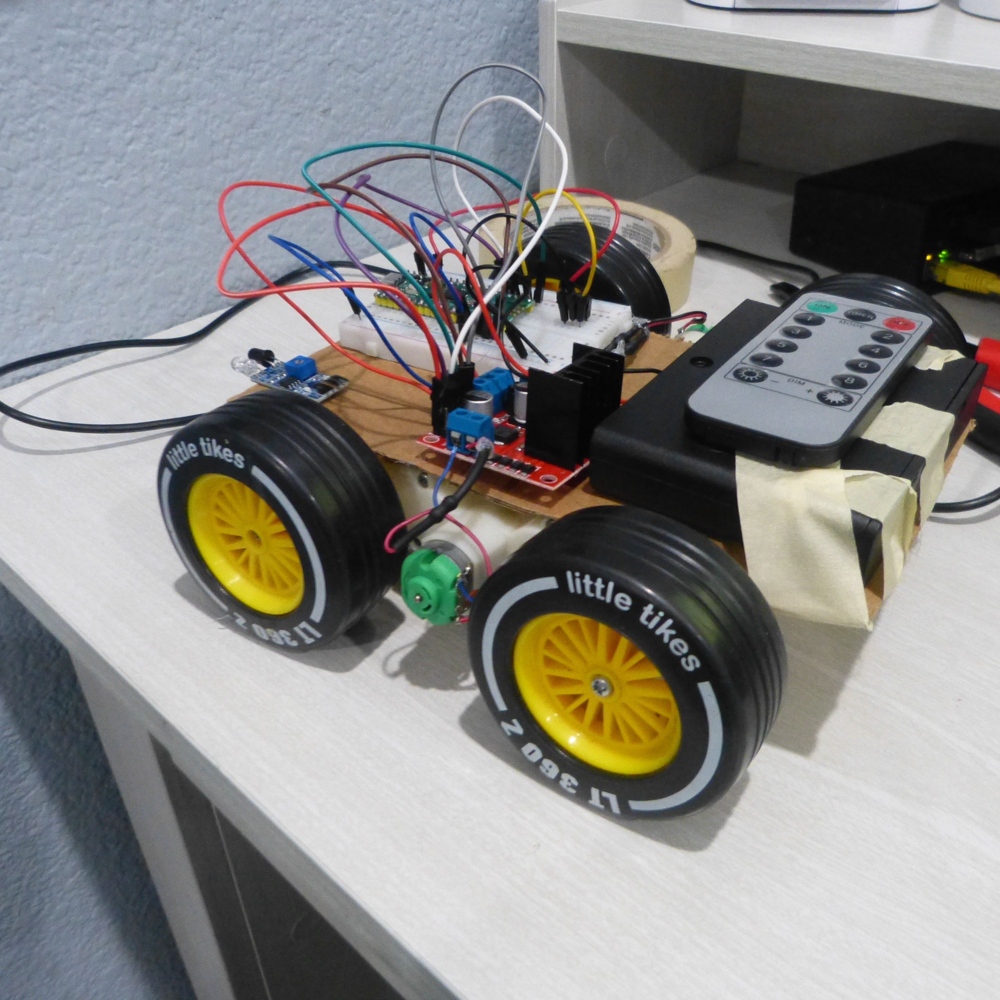

This is a custom rc car build that can be controlled with an ir remote. I took apart my rc car and harvested the battery box and motors, and turned it into this.
So far, I've only achieved forward, backward, and stop, but it works really nice. I also took apart my laser tag system to extract the ir reciver I needed. The
only thing I had to buy was a L298N driver. The total parts I used for this prototype was: An rc chassis with a gearbox and a single dc motor, a RP2040 raspberry
pi pico, a half sized breadboard, male to female jumper wires, an L298N Motor Driver, a Duracell 9v Alkaline battery, an ir reciver from my laser tag guns, and
a random ir remote I found in my garage with NEC protocol. Note: If your remote has a different protocol then NEC, you can go on github and find peterhinch, who
has the driver files for ir remotes with different protocols. For the assembly, start by putting your raspberry pi pico with header pins onto the breadboard, on top of the center divider.
Connect any GND pin from the pico to the negative rail on the breadboard. This rail will be your common ground. Next, take your ir reciver and use your male to 
female wires and slide it into each of the three pins on the reciver. The pinout may vary, but for me, when the bulb is facing you, the left most pin is the DATA 
pin, which connects to GP17 on the pico. The middle pin connects to the negative rail, and the right most pin goes to 3v3 OUT on the pico. Note: DO NOT connect 
the right most pin to VBUS. Putting 5v onto the reciver means it will return 5v to the GPIO pin, which runs on 3V. This risks breaking the pin, so just keep that 
in mind. Next, take your dc motor wires and your L298N driver and put the two wires of the dc motor into the out1 and out2 screw terminals on the driver. Screw them
tight. Then, take your battery of choice(keep it between 7.5V and 12V so you can use the jumper) and put its postive wire in the 12V screw terminal, and the negative
wire to the negative rail of your breadboard(remember, common ground is crucial). Take a jumper wire from your negative rail, and put it in the GND screw terminal 
of the driver. Screw those tight. Now, take two male to female jumper wires. Slide one into in1 and put the other end into GP15. Slide another wire into in2, and 
put the other end to GP16. Now the main circuit is done. When you turn the battery on, make sure that the onboard light on the L298N driver turns on. If it doesn't,
something with your wiring is wrong. While the battery is off, run the button mapping script for your ir remote in thonny IDE. Find the hex codes for the buttons
of your choice, and plug them in for the command lines in the main code. Remember to make a folder on your pico called lib, and in that folder put a folder called
ir_rx, and then put your nec.py and _init_.py in that folder, and those will be your driver files. These files are included in this repository.  Then, turn on your battery, plug in your pico, run the script, and watch the motors run! 

Note: 9V batteries are ok for this test, but they will instantly fail if you try and put the wheels on the ground. They might have 9V, but they have a very low
current and are not able to fully supply what the motors demand. This can drain your battery fast, so I would suggest using a 6AA battery holder. This gives you
a good 9V, and it provides the current you need. This will be able to work perfectly on the floor, and should also be able to power your pico through VSYS. 

#New and improved car - 11/5/26

After a lot of hard work and a lot of troubleshooting, I finally made a fully standalone robot that is controlled via ir remote, no usb cables connecting to a laptop. This car features a cardboard chassis, two gear motors harvested from an rc car, an L298n driver, a raspberry pi pico, half breadboard, ir receiver, 6 AA battery pack, ir remote with NEC protocol, a whole bunch of wires, and a lot of hot glue. The car can be controlled with 8 buttons: An on button for going forward, a button for reversing, an off button, a left button, a right button, and four buttons to control the speed through PWM signals. It works way better than I had expected! The speeds work great, and it reacts instantly to the remote commands. Here's how I made it: I got rid of the original prototype, because it only had one motor and no way of steering. I replaced the old 9v battery with a 6 AA battery, which still has 9v but way more mA of current to support the motors. I took a rectangular piece of cradboard and mounted my breadboard with the raspberry pi pico and the ir receiver. Next to it, I mounted the L298N driver with some screws. Behind that, I mounted the 6 AA battery pack with some tape. Now for the wiring. The right motor wires go to OUT3 and OUT4 screw terminals of the motor driver. The other motor wires go to OUT1 and OUT2. Next, take 6 male to female jumper wires. Slide them into ena, in1, in2, in3, in4, and enb. Connect ena to GP14, in1 to GP15, in2 to GP16, in3 to GP18, in4 to GP19, and enb to GP13. Next, take the ir reciver with the bulb facing you. Push the three legs into three empty rows of the breadboard. The left most leg should connect to GP17, the middle leg should connect to the negative rail of your breadboard, and the right most leg should be connected to the pico's 3v3 pin. Now, take a jumper wire and connect any GND pin on your pico to the negative rail. This will be your common ground rail. Push a wire into the GND terminal of the L298N, and push the other end into the negative rail of your breadboard. Now, its time to connect your battery. Take your 6 AA battery pack (or your battery of choice, best to keep it under 12V), and place it onto your chassis. Take the black wire and push it into the negative rail of the breadboard. Take the red wire and push into the 12V terminal of your L298N. You might be wondering how the pico is being powered. The L298N actually has its on 5V regulator that can step down the 9V into a stable 5V for the pico. Make sure the jumper cap for the regulator is on for this, or it won't work. Take a jumper wire and push it into the 5V OUT terminal of the L298N(right next to the GND terminal). Take the other end and push it into the VSYS pin of the pico, which allows it to be powered from an external source. Now, the physical wiring is complete. There is just one last step. Make sure your battery pack is switched off for this. Connect your usb to the laptop one last time, and save the code file I provided as main.py. The pico searches for main.py the second it is booted up with power, so it must be named main.py or else it will get overlooked. Once you save it onto the pico, you can disconnect your cable, switch on the box, and click the buttons!

Note: The ir receiver on the car was just put there to see the sizing. I'm planning on adding it for a future release! 
